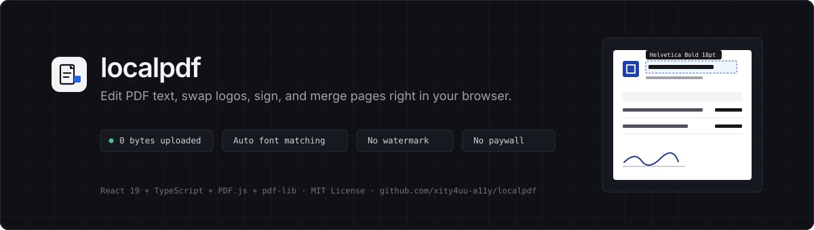

<p align="center">
  
</p>

# localpdf — Edit PDF text, swap logos, and download for free without hitting a paywall.

**Live App (runs 100% in your browser, zero uploads):** https://xity4uu-a11y.github.io/localpdf/

I built `localpdf` after spending ten minutes fixing two typos and a header logo in an invoice PDF on a popular web editor, clicking **Download**, and getting stopped by a subscription modal.

PDF files are just structured bytes. Modern browsers already have everything required to render pages (`pdfjs-dist`) and write modified PDFs (`pdf-lib`) right inside a single tab. There is no good reason to upload a resume, studio invoice, proposal, or event handout to a remote server just to fix a line of text or drop in a signature.

`localpdf` runs entirely in browser memory. Open a PDF, click existing text to replace it in a matched font, swap a logo, sign a page, reorder or merge PDFs, and click **Download PDF**. Zero accounts, zero watermarks, zero server uploads.

## Walkthrough

<p align="center">
  
</p>

> Want to record your own screencast GIF? Drop a `demo.gif` into `assets/demo.gif` and swap the image path above from `assets/demo-pdf-edit.svg` to `assets/demo.gif`.

## What Actually Works

- **Same-font text replacement:** Uses `pdfjs-dist` to read each text block's coordinates, PostScript/TrueType font descriptor, and size (`pt`), then maps embedded subset names (like `ABCDEF+Arial-BoldMT`, `TimesNewRomanPS-ItalicMT`, `Georgia`, `CourierNew`, `Inter`, `JetBrainsMono`) to the closest PDF standard family (`Helvetica`, `Times`, `Courier`) plus bold/italic weight. It also samples the rendered page canvas around the bounding box to match the underlying background color and ink color automatically.
- **Add new text anywhere:** Click anywhere on a page to place single- or multi-line text with family, bold/italic, size, color, and drag-to-reposition.
- **Two-click logo & image replacement:** Drop in a local PNG or JPEG, drag and corner-resize with aspect-ratio lock, and keep **Cover underlying logo** checked to paint a clean opaque backing right behind your new mark.
- **Whiteout & shapes:** Drag to cover outdated dates, prices, borders, or notes with a sampled or custom cover box, bordered rectangle, or horizontal rule.
- **Signature pad:** Draw freehand with smooth strokes (exported as a transparent PNG overlay) or type a clean italic signature and place it anywhere on your document.
- **Page organizer & PDF merger:** Reorder pages, rotate 90 degrees, delete pages, insert blank pages, or merge another local PDF into your current file.
- **Undo / Redo & built-in sample PDF:** Full `Ctrl+Z` / `Ctrl+Y` history stack, plus a built-in **Open Sample Invoice & Resume PDF** button generated locally via `pdf-lib` so you can try every tool immediately without searching for a test file.
- **Community presets (`plugins/`):** Five validated JSON preset packs for invoices, resumes, workshop/event certificates, approval stamps, and PDF packet merges.

## Good Fit For

- Updating dates, totals, contact details, or company logos on your own invoices and proposals
- Fixing a typo or adding a new role on an exported resume PDF
- Personalizing workshop, course, or event templates
- Adding a signature to a freelance agreement or handout
- Combining a cover letter, resume, and portfolio PDF into one file before sending

## Honest Limitations

Because `localpdf` stays lightweight and 100% browser-local:

1. **Font matching uses the 14 built-in PDF StandardFonts** (`Helvetica`, `Times`, `Courier` in Regular, Bold, Italic/Oblique, and Bold Italic). If a document uses a custom proprietary display font, `localpdf` matches the closest sans/serif/mono family and weight rather than reflowing proprietary font glyphs.
2. **Scanned image-only PDFs** do not contain selectable text runs. For scanned pages, use the **Whiteout** tool followed by **Add Text** (no OCR runs yet).
3. **Password-protected PDFs** with open-passwords cannot be decrypted automatically.

## Run Locally

Requires Node.js 20+.

```bash
git clone https://github.com/xity4uu-a11y/localpdf.git
cd localpdf
npm install
npm run dev
```

Open the local URL Vite prints (typically `http://localhost:5173`). You can disconnect from Wi-Fi after loading the page — the PDF.js worker is bundled locally with zero external CDN requests.

## Verification & Tests

```bash
npm run validate-plugins   # Validates all JSON preset manifests against plugins/schema.json
npm run typecheck          # Strict TypeScript check (tsc --noEmit)
npm test                   # Vitest suite against real pdf-lib generated & exported PDFs
npm run build              # Production static bundle in dist/
```

## Deploy Static (Zero Backend Needed)

`vite.config.ts` sets `base: './'` and bundles the PDF.js worker as a local static asset, so `dist/` runs anywhere static files are served:

- **GitHub Pages / Cloudflare Pages / Netlify / Vercel:** Run `npm run build` and publish the `dist/` directory.
- **Self-hosted Docker (nginx with strict local-only CSP):**

```bash
docker build -t localpdf .
docker run --rm -p 8080:80 localpdf
```

## Architecture Overview

```text
localpdf/
├── src/
│   ├── lib/
│   │   ├── fontMatcher.ts    # Subset-prefix stripping, font family/weight mapping, canvas color sampling
│   │   ├── pdfInspector.ts   # Offline pdfjs-dist worker setup, HiDPI rendering, baseline text merging
│   │   ├── pdfEditor.ts      # Non-destructive pdf-lib export engine (text, logos, whiteout, signatures, merge)
│   │   ├── samplePdf.ts      # Built-in 2-page sample PDF + pure-TS PNG encoder
│   │   ├── presets.ts        # Bundled plugin loader & font alias collector
│   │   └── types.ts          # Shared TypeScript domain models
│   ├── components/           # Toolbar, PageSidebar, PdfWorkspace, InspectorPanel, SignatureModal
│   └── styles/app.css        # Light & dark design tokens
├── plugins/                  # JSON Schema + 5 bundled typography/template/workflow presets
├── scripts/
│   └── validate-plugins.mjs  # Schema validator for community plugin manifests
├── tests/
│   └── pdfEditor.test.ts     # Real PDF generation, edit application, re-load & plugin tests
└── assets/                   # Minimalist banner and animated walkthrough SVG
```

## Contributing

Contributions — especially new typography presets in `plugins/`, better font-alias rules, keyboard ergonomics, and browser PDF edge-case fixes — are welcome. See [CONTRIBUTING.md](CONTRIBUTING.md).

## License

MIT — see [LICENSE](LICENSE).
